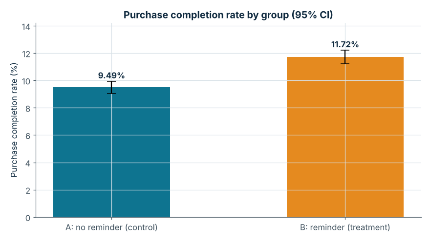
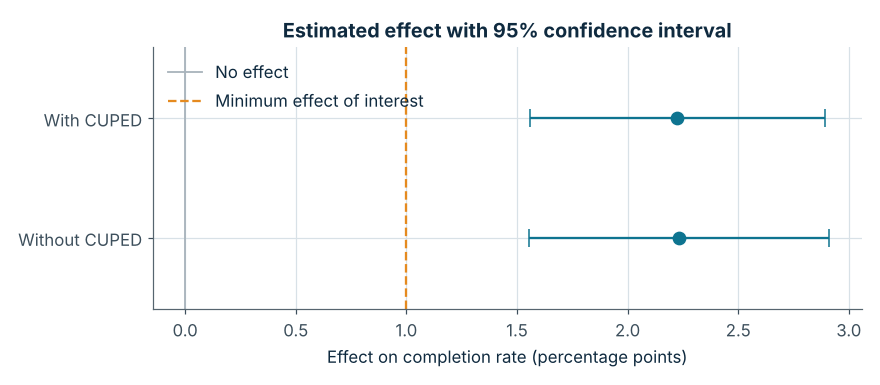
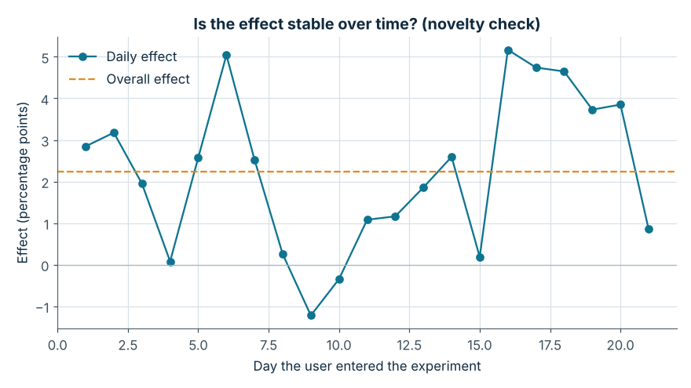
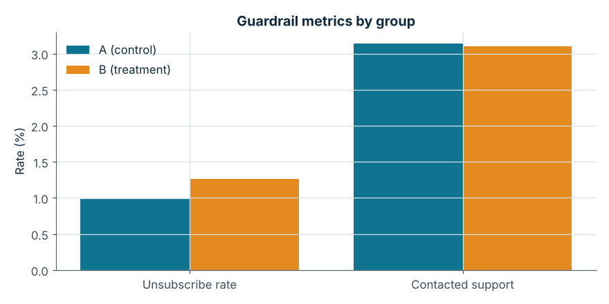

# قياس أثر تذكير السلة المتروكة على معدل إتمام الشراء

- **الاسم:** بسام فيصل الزهراني
- **اسم الدورة:** التجارب واختبارات A/B والاستدلال السببي (A/B Testing and Causal Inference)
- **الجهة المقدمة:** أكاديمية سدايا — [https://github.com/SDAIAAcademy](https://github.com/SDAIAAcademy)
- **المنتج محل الدراسة:** متجر إلكتروني (بيانات محاكاة)

---

## 1. بيانات المشروع

- **المشكلة:** نسبة كبيرة من مستخدمي المتجر يضيفون المنتجات إلى السلة ويغادرون دون إتمام عملية الدفع (Cart Abandonment).
- **الهدف:** تقييم فعالية إرسال رسالة تذكير (عبر البريد الإلكتروني أو الإشعارات) للمستخدمين الذين تركوا سلاتهم.
- **القرار المطلوب:** هل نطلق ميزة التذكير بشكل دائم لجميع المستخدمين، أم لا؟

## 2. السؤال والفرضية

**السؤال الرئيسي:**

> هل يؤدي إرسال رسالة تذكير للمستخدمين بعد ترك السلة بـ 24 ساعة إلى زيادة نسبة إتمام الشراء؟

**الفرضية:**

> إذا أرسلنا رسالة تذكير للمستخدمين الذين تركوا سلاتهم، فمن المتوقع أن ترتفع نسبة إتمام الشراء؛ لأن التذكير يعيد تفاعل المستخدمين مع المتجر ويقلل من نسيان الطلبات المكتملة جزئياً.

- **المعالجة (التغيير المختبَر):** إرسال رسالة تذكير بعد 24 ساعة من ترك السلة.
- **الأثر المتوقع واتجاهه:** زيادة في نسبة إتمام الشراء.
- **سبب توقع الأثر:** التذكير يعيد المستخدم إلى سلته ويقلل احتمال نسيان الطلب.

## 3. تصميم التجربة (A/B Test)

| العنصر | التفاصيل |
|---|---|
| المجتمع المستهدف | المستخدمون المسجلون الذين أضافوا منتجاً واحداً على الأقل للسلة ولم يكملوا الدفع خلال 24 ساعة |
| وحدة العشوائية | معرّف المستخدم (`user_id`) لتقليل تداخل المجموعتين |
| مجموعة المقارنة (A) | لا تتلقى أي رسالة تذكير (الوضع الحالي) |
| مجموعة المعالجة (B) | تتلقى رسالة تذكير بعد 24 ساعة من ترك السلة |
| نسبة التوزيع | 50% / 50% |
| طريقة التوزيع | توزيع ثابت (Deterministic Hashing) على `user_id` مع ملح خاص بالتجربة، فيبقى المستخدم في نفس المجموعة دائماً |
| مدة التجربة | 21 يوماً (3 أسابيع كاملة) |

## 4. المقاييس

- **المقياس الرئيسي (Primary Metric):** نسبة إتمام الشراء = المستخدمون الذين أتموا الدفع ÷ إجمالي من دخلوا التجربة.
- **مقاييس الحماية (Guardrail Metrics):**
  - نسبة إلغاء الاشتراك من رسائل المتجر (كل رسائل المتجر، حتى تكون المقارنة بين المجموعتين ممكنة).
  - نسبة التواصل مع خدمة العملاء (مؤشر على انزعاج المستخدمين).
- **مقياس ثانوي:** الإيراد لكل مستخدم (ريال).

## 5. حجم العينة ومدة التجربة

| العنصر | القيمة |
|---|---|
| مستوى الدلالة الإحصائية (α) | 0.05 (اختبار ثنائي الاتجاه) |
| القوة الإحصائية المستهدفة | 80% |
| نسبة إتمام الشراء الحالية (Baseline) | 10% |
| أصغر أثر قابل للاكتشاف (MDE) | 1 نقطة مئوية (من 10% إلى 11%) |
| حجم العينة المطلوب لكل مجموعة | 14,749 مستخدماً |
| عدد المستخدمين المتوقع دخولهم يومياً | 1,500 |
| المدة المقدّرة | 20 يوماً، قُرّبت إلى 21 يوماً لتغطية أسابيع كاملة |

**طريقة الحساب:** معادلة حجم العينة لمقارنة نسبتين بالتقريب الطبيعي:
`n = (z_α/2 + z_β)² × [p1(1−p1) + p2(1−p2)] / (p2 − p1)²`
وهي منفّذة في الدالة `n_per_group_proportions` داخل `main.py`. نسبة الأساس وعدد المستخدمين اليومي وأصغر أثر كلها افتراضات، لأن البيانات محاكاة.

## 6. البيانات وفحوص الجودة

- **مصدر البيانات:** **محاكاة**، يولّدها `main.py` ببذرة ثابتة (`seed = 2026`) ويحفظها في `data/dataset.csv`. ليست بيانات متجر حقيقي.
- **الحجم:** 31,500 مستخدم (صف لكل مستخدم) و9 أعمدة.

| العمود | المعنى |
|---|---|
| `user_id` | معرّف المستخدم |
| `variant` | المجموعة: A أو B |
| `day` | يوم دخول المستخدم التجربة (1 إلى 21) |
| `pre_orders_90d` | عدد طلباته في آخر 90 يوماً قبل التجربة (يُستخدم في CUPED) |
| `ordered` | هل أتم الشراء؟ (1/0) |
| `order_value` | قيمة الطلب بالريال (فارغة لمن لم يشترِ) |
| `revenue` | الإيراد من المستخدم (0 لمن لم يشترِ) |
| `unsubscribed` | هل ألغى الاشتراك من الرسائل؟ (1/0) |
| `contacted_support` | هل تواصل مع خدمة العملاء؟ (1/0) |

**افتراضات المحاكاة** (كلها في `CONFIG` أعلى `main.py`):

- نسبة الإتمام بدون تذكير 10%، وتختلف بين المستخدمين حسب نشاطهم.
- الأثر الحقيقي للتذكير +1.5 نقطة مئوية، مع زيادة مؤقتة 30% في الأيام الأولى (أثر حداثة).
- متوسط قيمة الطلب 180 ريالاً بانحراف معياري 60.
- إلغاء الاشتراك: 1.0% أساساً، ويرفعه التذكير 0.2 نقطة مئوية.
- التواصل مع الدعم: 3.0% أساساً، ويرفعه التذكير 0.05 نقطة مئوية.

**فحوص الجودة:**

| الفحص | النتيجة |
|---|---|
| توزيع المجموعتين | A = 15,696 و B = 15,804 |
| اختلال نسبة التوزيع (SRM) | χ² = 0.37، p = 0.543: التوزيع سليم |
| سجلات مكررة (`user_id`) | 0 |
| قيم مفقودة | 0 (عدا `order_value` الفارغة عمداً لمن لم يشترِ) |
| تناقض بين الطلب وقيمته | 0 |

إذا فشل فحص SRM أو وُجدت سجلات مكررة، يتوقف السكربت قبل التحليل.

## 7. المنهجية والتحليل

- **اختبار الفرق بين نسبتين** بالتقريب الطبيعي مع **فترة ثقة 95%** وقيمة p. اخترناه لأن المقياس الرئيسي ثنائي (أتم/لم يتم)، والتوزيع عشوائي، والعينة كبيرة.
- **CUPED** لتقليل التباين باستخدام طلبات المستخدم قبل التجربة (`pre_orders_90d`).
- **مقاييس الحماية:** نعتبر المقياس "متدهوراً" إذا كانت فترة الثقة 95% لارتفاعه كلها فوق الصفر.
- **فحص أثر الحداثة:** مقارنة الأثر في الأسبوع الأول بالأسبوع الأخير، ورسم الأثر اليومي.
- **قاعدة القرار** محددة مسبقاً في الدالة `decide`: نطلق فقط إذا كان الأثر إيجابياً بثقة ومقاييس الحماية سليمة.

## 8. النتائج والتفسير

| المقياس | A (مقارنة) | B (معالجة) | الأثر المقدَّر | فترة الثقة 95% | قيمة p |
|---|---|---|---|---|---|
| **نسبة إتمام الشراء** | 9.49% | 11.72% | +2.23 نقطة مئوية | +1.55 إلى +2.91 | < 0.001 |
| نسبة الإتمام مع CUPED | - | - | +2.22 نقطة مئوية | +1.56 إلى +2.89 | < 0.001 |
| الإيراد لكل مستخدم (ريال) | 17.04 | 21.09 | +4.05 | +2.76 إلى +5.35 | < 0.001 |
| إلغاء الاشتراك (حماية) | 0.99% | 1.27% | +0.28 نقطة مئوية | +0.04 إلى +0.51 | 0.019 |
| التواصل مع خدمة العملاء (حماية) | 3.14% | 3.10% | −0.04 نقطة مئوية | −0.42 إلى +0.34 | 0.836 |

- **الأهمية الإحصائية:** الأثر على المقياس الرئيسي دال إحصائياً (p < 0.001)، وفترة الثقة كلها فوق الصفر وفوق أصغر أثر مهم (1 نقطة).
- **الأهمية التجارية:** زيادة نسبية 23.5% في إتمام الشراء، أي نحو 22 طلباً إضافياً لكل 1,000 مستخدم، وزيادة تقديرية في الإيراد بين 1.5 و2.9 مليون ريال سنوياً (بافتراض 547,500 مستخدم مؤهل في السنة).
- **حالة مقاييس الحماية:**
  - إلغاء الاشتراك: **تدهور دال**، ارتفع من 0.99% إلى 1.27% (نحو 3 إلغاءات إضافية لكل 1,000 مستخدم).
  - التواصل مع خدمة العملاء: **سليم**، لا فرق.
- **أثر الحداثة:** الأثر في الأسبوع الأول +2.61 نقطة وفي الأسبوع الأخير +3.31 نقطة، فلا يوجد دليل على أن الأثر يتلاشى مع الوقت.
- **CUPED:** قلّل التباين 3.9% فقط، وهذا متوقع مع مقياس ثنائي.

**الرسوم** (في `outputs/charts/`):






التقرير الكامل في `outputs/results/report.md` وجدول النتائج في `outputs/results/results.csv`.

## 9. التوصية النهائية

**القرار: تعديل التغيير وإعادة التجربة (لا نطلق الآن).**

**المبررات:**

1. التذكير رفع نسبة إتمام الشراء بوضوح (+2.23 نقطة مئوية، وفترة الثقة فوق أصغر أثر مهم).
2. لكنه رفع نسبة إلغاء الاشتراك بشكل دال، وقاعدة القرار المحددة مسبقاً تمنع الإطلاق عند تدهور أي مقياس حماية.
3. إلغاء الاشتراك خسارة دائمة لقناة التواصل مع العميل، فلا نتجاوزه لمجرد أن المقياس الرئيسي تحسن.

**الخطوة التالية:** تعديل الرسالة (تذكير واحد فقط لكل سلة، وخيار واضح لتقليل الرسائل بدل إلغائها كلها)، ثم إعادة التجربة مع تحديد حد مقبول لارتفاع إلغاء الاشتراك قبل البدء.

## 10. القيود والافتراضات

- البيانات محاكاة، والنتائج تثبت صحة خط التحليل ولا تثبت أثراً في متجر حقيقي.
- الأثر الحقيقي المُدخل في المحاكاة نحو 1.6 نقطة مئوية، والتقدير 2.23 نقطة. القيمة الحقيقية داخل فترة الثقة، والفرق سببه العشوائية.
- لم نصحح قيم p لمقاييس الحماية للاختبارات المتعددة، وهذا مقصود: نفضّل التحفظ في الحماية.
- نقيس الأثر خلال 21 يوماً فقط، ولا نعرف الأثر طويل المدى (مثل تعوّد المستخدمين على الرسائل).
- التجربة على المستخدمين المسجلين فقط، فلا تُعمَّم النتائج على الزوار.
- الإيراد محسوب قبل تكلفة إرسال الرسائل وقبل هامش الربح.

## 11. هيكل المستودع

```text
abandoned-cart-ab-test/
│
├── README.md
├── main.py
├── requirements.txt
├── data/
│   └── dataset.csv
└── outputs/
    ├── charts/
    │   ├── conversion_by_group.png
    │   ├── effect_ci.png
    │   ├── daily_lift.png
    │   └── guardrails.png
    └── results/
        ├── report.md
        └── results.csv
```

## 12. طريقة التشغيل

1. تثبيت المتطلبات:
   ```bash
   pip install -r requirements.txt
   ```

2. تشغيل التجربة وطباعة التقرير:
   ```bash
   python main.py
   ```

السكربت يقرأ `data/dataset.csv` إن وُجد. لإعادة توليد البيانات من الصفر، احذف الملف ثم شغّل السكربت. جُرّب على Python 3.12.

## 13. عن البرنامج

نُفّذ هذا المشروع ضمن برنامج «التجارب واختبارات A/B والاستدلال السببي» في أكاديمية سدايا، نوفمبر 2026.
حساب أكاديمية سدايا على GitHub: [https://github.com/SDAIAAcademy](https://github.com/SDAIAAcademy)
